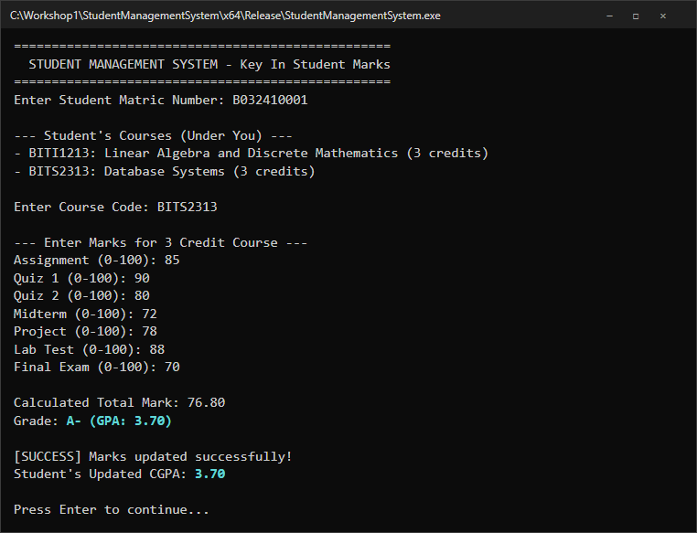
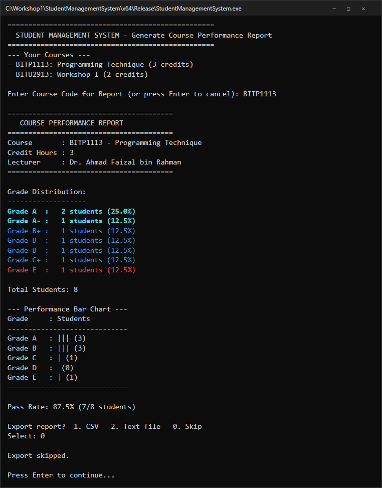
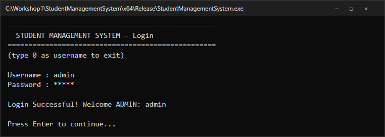
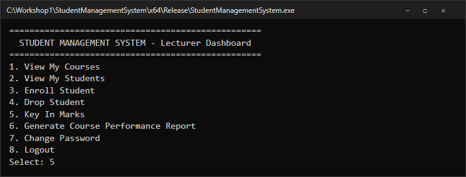
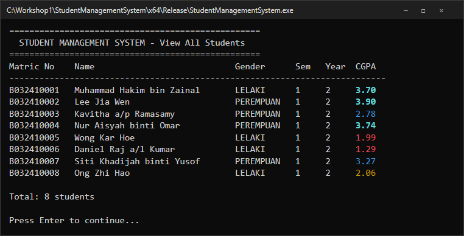
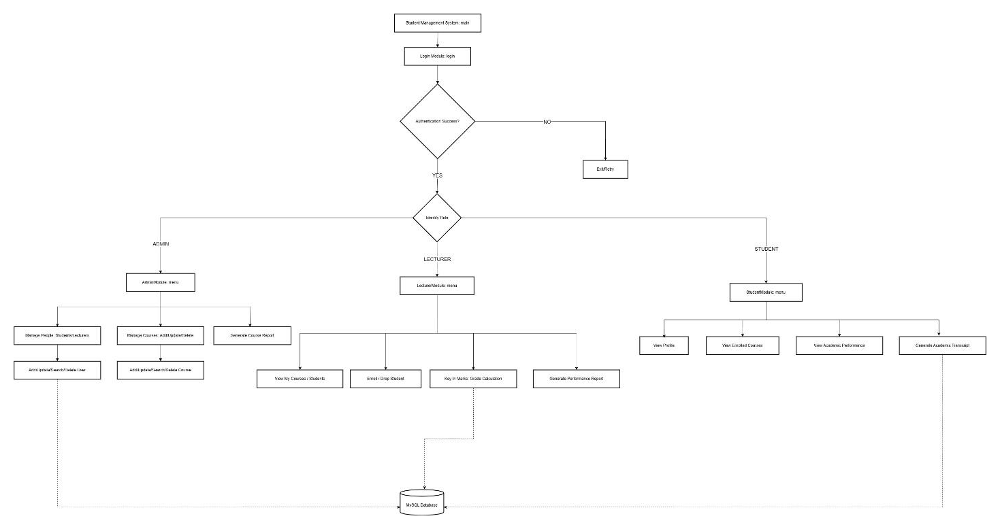
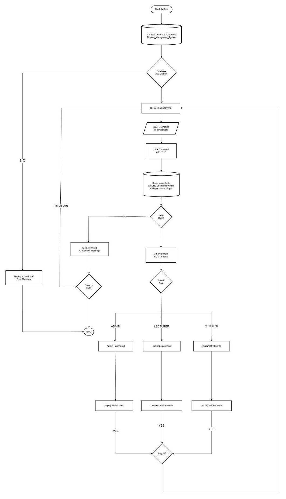
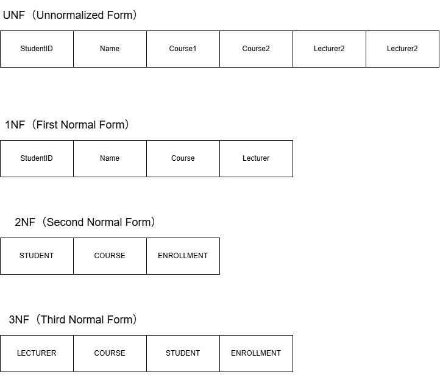
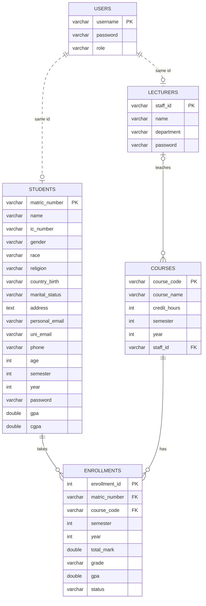

# Student Management System (C++ Version)


My Workshop I project. A console program for the faculty to keep student, lecturer and course records, key in marks and work out GPA and CGPA with the UTeM grading scale. Data is stored in MySQL (XAMPP) through MySQL Connector/C++.

<table>
  <tr>
    <td width="50%"></td>
    <td width="50%"></td>
  </tr>
  <tr>
    <td align="center"><b>Key In Marks</b></td>
    <td align="center"><b>Course Performance Report</b></td>
  </tr>
</table>

<table>
  <tr>
    <td width="33%"></td>
    <td width="33%"></td>
    <td width="33%"></td>
  </tr>
  <tr>
    <td align="center">Login</td>
    <td align="center">Lecturer Dashboard</td>
    <td align="center">View All Students</td>
  </tr>
</table>

## Workshop I

| | |
|---|---|
| Programme | Bachelor of Computer Science (Artificial Intelligence) |
| Faculty | Faculty of Artificial Intelligence and Cyber Security, UTeM |
| Semester | Year 2 Semester 1, 2025/2026 |

## Problem and Objectives

The faculty kept student records by hand in separate files and folders. Records were duplicated and hard to find, enrollment was slow, lecturers worked out grades and GPA with a calculator, and there were no ready reports on how a course performed.

1. Three modules with full CRUD: Admin (users and courses), Lecturer (grading and enrollment) and Student (profile and transcript).
2. Automatic calculation of total marks, grades, GPA and CGPA.
3. Academic transcripts and course performance reports with a bar chart.

## Timeline

The project ran over 14 weeks.

| Task | 1 | 2 | 3 | 4 | 5 | 6 | 7 | 8 | 9 | 10 | 11 | 12 | 13 | 14 |
|---|---|---|---|---|---|---|---|---|---|---|---|---|---|---|
| Project Planning | ■ | ■ |  |  |  |  |  |  |  |  |  |  |  |  |
| System Design |  |  | ■ | ■ |  |  |  |  |  |  |  |  |  |  |
| Coding & Testing |  |  |  |  | ■ | ■ | ■ | ■ | ■ | ■ | ■ | ■ | ■ |  |
| Documentation |  |  |  |  |  |  |  |  |  |  |  | ■ | ■ | ■ |

## Analysis

The problem was split by user. Admin needs clean records with no duplicates, lecturers need grades worked out without maths mistakes, and students need to see their own results. The structured chart shows how login leads to each role and every function reads and writes the same MySQL database.

<p align="center"></p>

## Features

| Role | What it can do |
|---|---|
| Admin | Add, view, search, update and delete students. Add, view and delete lecturers. Add, view, update and delete courses. Course grade report with CSV export |
| Lecturer | View own courses and students. Enroll and drop students. Key in marks. Course performance report with bar chart, export to CSV or text |
| Student | View profile, enrolled courses and results. Generate an academic transcript. Change password |

A new student gets the next matric number (`B032410XXX`), a university email and a first password from the last 6 digits of the IC. Passwords are shown as `*` while typing.

## Business Rules

- Matric numbers (`B032410XXX`) and staff IDs (`L001`) are unique.
- Each user can only open the menu for their own role.
- Course codes are unique and a course has 1, 2 or 3 credit hours.
- Deleting a student also deletes their enrollments, marks and login.
- Marks must be between 0 and 100, and 40 or more is a pass.

## Grading

Marks are 0 to 100. The total mark depends on the credit hours of the course.

| Credit hours | Weightage |
|---|---|
| 3 | Assignment 10%, Quiz 1 5%, Quiz 2 5%, Midterm 20%, Project 20%, Lab 10%, Final 30% |
| 2 | Assignment 1 30%, Assignment 2 40%, Final 30% |
| 1 | Test 100% (co-curriculum) |

| Mark | 80+ | 75+ | 70+ | 65+ | 60+ | 55+ | 50+ | 47+ | 44+ | 40+ | below 40 |
|---|---|---|---|---|---|---|---|---|---|---|---|
| Grade | A | A- | B+ | B | B- | C+ | C | C- | D+ | D | E |
| GPA | 4.00 | 3.70 | 3.30 | 3.00 | 2.70 | 2.30 | 2.00 | 1.70 | 1.30 | 1.00 | 0.00 |

CGPA = sum of (GPA × credit hours) / sum of credit hours. A student passes a course with 40 marks or more.

## Design

<table>
  <tr>
    <td width="55%"></td>
    <td width="45%" valign="top"></td>
  </tr>
  <tr>
    <td align="center">Flowchart</td>
    <td align="center">Normalization</td>
  </tr>
</table>

The ERD below matches [schema.sql](database/schema.sql). `users.username` holds the matric number or staff ID, so every student and lecturer has one login.



## Programming Concepts

| Concept | Where it is used |
|---|---|
| Naming convention | PascalCase classes (`AdminModule`), camelCase functions and variables (`keyInMarks`, `totalMark`), snake_case SQL columns (`matric_number`) |
| Function | `addStudent()` makes the matric number, email and first password, then saves the student and the login |
| Array | `char buffer[100]` formats the date in `getCurrentDateTime()`, `GRADES[]` keeps the grade order in reports |
| Selection | `switch` in every menu, `if` chain in `calculateGrade()` |
| Control | `while (true)` keeps each menu running until logout |
| Pointer | One `sql::Connection*` shared by all modules, `unique_ptr` for every `PreparedStatement` and `ResultSet` |
| Error handling | `try` / `catch (sql::SQLException&)` around queries; a failed connection leaves `conn` as `nullptr` |

## Getting Started

1. Install [XAMPP](https://www.apachefriends.org/) and start **MySQL** in the XAMPP Control Panel.
2. Open phpMyAdmin, import `database/schema.sql`, then `database/sample_data.sql`.
3. Install [MySQL Connector/C++ 8.0](https://dev.mysql.com/downloads/connector/cpp/) (Windows x64) to the default folder `C:\Program Files\MySQL\MySQL Connector C++ 8.0`.
4. Open `StudentManagementSystem.sln` in Visual Studio 2022, choose **x64** and run. The Connector DLLs are copied next to the `.exe` after each build.

The program connects to `127.0.0.1:3306` as `root` with no password, the XAMPP default. Change it in `src/DBConnection.h` if yours is different.

Demo accounts from `sample_data.sql`:

| Role | Username | Password |
|---|---|---|
| Admin | `admin` | `admin` |
| Lecturer | `L001`, `L002`, `L003` | `123456` |
| Student | `B032410001` | `101234` |

All names and IC numbers in the sample data are made up.

## Project Structure

```text
StudentManagementSystemCppVersion/
├── StudentManagementSystem.sln
├── src/
│   ├── main.cpp            # login
│   ├── DBConnection.h      # mysql connection
│   ├── Utils.h             # input and screen helpers
│   ├── Admin.h             # admin module
│   ├── Lecturer.h          # marks, grading, reports
│   ├── Student.h           # profile, results, transcript
│   └── Report.h            # grade distribution report
├── database/
│   ├── schema.sql
│   └── sample_data.sql
└── docs/                   # design and screenshots
```

## Constraints and Future Work

- It is a console program, so the interface is simpler than a GUI.
- It connects to one local MySQL server (`127.0.0.1:3306`), which does not suit a campus network.
- Results are only as accurate as the marks lecturers key in.

Next steps would be a GUI or web version, a cloud database, checks on marks before they are saved, and a mobile app with result notifications.
